# Secrets Behind the NVIDIA RTX PRO 6000 Blackwell

## A CUDA microbenchmark study of GB202 (sm_120)

**Device:** NVIDIA RTX PRO 6000 Blackwell Server Edition  
**Date:** 2026-10-24  
**Software:** CUDA 13.4, driver 615.71.10, Rocky Linux 8.10  
**Code:** `gpgpu-microbenchmark/rtx-pro-6000-blackwell`

---

## 1. Description

This report is a microbenchmark-driven dissection of the NVIDIA RTX PRO 6000
Blackwell Server Edition, a GB202-based workstation/server GPU with compute
capability `sm_120`. It follows the spirit of the original *Secrets Behind
NVIDIA GPGPU* report, which used small CUDA programs to answer concrete
questions about an H20 system: how many NVLinks are used, what the NoC topology
is, how deep the memory hierarchy is, and where the bandwidth goes.

The original report was written for a multi-GPU H20 system with NVLink and
NVSwitch. This system is a **single GPU** with no NVLink. The questions are
therefore re-aimed at the single-die architecture:

- What does one Blackwell SM look like, and what limits occupancy?
- What are the L1, L2, and HBM latencies and capacities?
- How fast is GDDR7 in practice, compared with the 1.792 TB/s marketing number?
- How fast are the FP32, FP64, INT32, SFU, and tensor-core pipelines?
- Is the on-chip network a crossbar or a distance-dependent mesh?
- What does the PCIe link actually train to?
- How does the GPU behave under sustained load: clock, power, temperature, and
  throttling?

Every number in this report was measured on the card described in Section 3.
Where a number is derived rather than measured, it is labelled as such. The RT
cores, texture units, and media engines are outside the scope of this study;
they require a different methodology (BVH traversal, texture filtering, and
video encode/decode benchmarks).

The companion repository is at
<https://github.com/baichen318/gpgpu-microbenchmark/tree/main/rtx-pro-6000-blackwell>. It contains
the CUDA sources, build system, raw CSV data, and the scripts that regenerate
the figures and tables:

```text
rtx-pro-6000-blackwell/
  include/common.cuh
  src/bench_device.cu
  src/bench_latency.cu
  src/bench_bandwidth.cu
  src/bench_cache.cu
  src/bench_compute.cu
  src/bench_tensor.cu
  src/bench_noc.cu
  src/bench_pcie.cu
  src/bench_scheduler.cu
  src/bench_power.cu
  scripts/run_all.sh
  scripts/make_figures.py
  results/raw/*.csv
  report/figures/*.svg
```

---

## 2. Revision History

| Date | Version | Note |
|---|---|---|
| 2026-10-24 | 1.0 | Initial document. Ten tests: device topology, memory latency, HBM bandwidth, cache/shared bandwidth, scalar pipelines, tensor cores, on-chip NoC, PCIe, warp scheduler, power/clock. |

---

## 3. System Overview

### 3.1 Hardware and software

| Component | Detail |
|---|---|
| GPU | NVIDIA RTX PRO 6000 Blackwell Server Edition (GB202, `sm_120`) |
| SMs | 188 |
| FP32 lanes | 24,064 (188 SMs × 128 lanes; inferred from the measured FP32 rate and the GB202 specification) |
| Tensor cores | 4 per SM (752 total; inferred from the tensor throughput scaling) |
| Memory | 96 GB GDDR7 with ECC, 512-bit bus |
| Memory clock | 12,481 MHz (reported by NVML) |
| Clock-derived HBM peak | 1,598 GB/s (2 × 12,481 MHz × 512 bit / 8) |
| Marketing HBM peak | 1,792 GB/s |
| L2 cache | 128 MiB |
| Shared memory | 100 KiB per SM; 99 KiB opt-in per block; 1 KiB reserved |
| Registers | 65,536 per SM |
| Max threads per SM | 1,536 (48 warps) |
| Max blocks per SM | 24 |
| Max cluster size | 8 blocks |
| Copy engines | 2 |
| Power limit | 600 W (default, requested, and current) |
| PCIe | Gen5 x16 capable; trained to **Gen5 x8** in this system |
| VBIOS | 98.02.8D.00.01 |
| Driver / CUDA | 615.71.10 / 13.4 |
| OS | Rocky Linux 8.10, kernel 4.18.0-553.134.1.el8_10.x86_64 |
| CPU | 2 × Intel Xeon Gold 6530, 32 cores / 64 threads each (128 vCPU total) |
| Host memory | 250 GiB |
| NUMA | GPU on NUMA node 1; CPU affinity 32-63, 96-127 |
| ECC | Enabled |
| MIG | Disabled |
| Persistence mode | Enabled |

The GPU was idle before and after the measurements (`nvidia-smi` showed no
processes), and no MIG instance was active. The machine is shared, so the usual
caveats about run-to-run variance apply; all measurements use medians of
multiple repetitions.

### 3.2 Topology

```text
        +---------------------+          +---------------------+
        | Socket 0            |          | Socket 1            |
        | Xeon Gold 6530      |          | Xeon Gold 6530      |
        | 32C / 64T           |          | 32C / 64T           |
        +----------+----------+          +----------+----------+
                   |                                |
                   +---------------+----------------+
                                   |
                          PCIe 5.0 x8 (active)
                                   |
                        +----------+----------+
                        | RTX PRO 6000        |
                        | Blackwell 96 GB     |
                        | 188 SMs, 128 MB L2  |
                        +---------------------+
```

`nvidia-smi topo -m` reports GPU0 on NUMA node 1 with CPU affinity
`32-63,96-127`. The link is capable of Gen5 x16 but trained to x8; see Test 8.

### 3.3 Measurement methodology

- **Timing:** CUDA events for kernel and copy timing; `clock64()` for
  per-SM cycles; `%globaltimer` for cross-SM timestamps in the NoC test.
- **Repetition:** medians of 3-10 runs after warm-up. The latency sweep uses
  three repetitions of a full ring walk; the bandwidth sweep uses five.
- **Cache control:** a 256 MiB buffer (larger than L2) is written before
  cold-cache measurements to evict the previous working set. Warm measurements
  intentionally keep the working set resident.
- **Pointer chasing:** one node per 64 B cache line, an odd stride that forms a
  single cycle through all nodes, and a full-ring walk. A short walk would
  under-estimate the cache capacity; this is discussed in Test 2.
- **Power/clock:** NVML sampling every 500 ms during an 18.5 s sustained FP32
  kernel and an 18 s FP4 tensor kernel.
- **No clock locking:** application clocks are not set; the GPU boosts and
  throttles according to its own policy. The measured sustained SM clock was
  2,422 MHz, 8 MHz below the 2,430 MHz maximum.
- **No MIG, no NVLink:** the card is a single logical GPU. Multi-GPU tests from
  the H20 report (NVLink, peer-to-peer, NVSwitch) do not apply.

---

## 4. Secrets

### 4.1 Test 1: What does one Blackwell SM look like?

**Question:** How many SMs, warps, registers, shared-memory bytes, and L2 bytes
does the GPU expose, and what is the occupancy envelope?

**Answer:** 188 SMs; 48 warps (1,536 threads) per SM; 24 blocks per SM; 65,536
registers per SM; 100 KiB shared memory per SM (99 KiB opt-in per block); 128
MiB L2; 8-block clusters; 2 copy engines.

#### Test Case

`src/bench_device.cu` queries `cudaGetDeviceProperties` and the occupancy API.
The occupancy table launches an empty kernel at block sizes from 32 to 1,024
threads and reports the maximum resident blocks and warps per SM.

#### Experimental Results

| Property | Value |
|---|---|
| SMs | 188 |
| Compute capability | 12.0 (`sm_120`) |
| Max threads per SM | 1,536 |
| Max warps per SM | 48 |
| Max blocks per SM | 24 |
| Registers per SM | 65,536 |
| Registers per block | 65,536 |
| Shared memory per SM | 102,400 B (100 KiB) |
| Shared memory per block (default) | 49,152 B (48 KiB) |
| Shared memory per block (opt-in) | 101,376 B (99 KiB) |
| Reserved shared memory per block | 1,024 B |
| L2 cache | 134,217,728 B (128 MiB) |
| Max persisting L2 | 83,886,080 B (80 MiB) |
| Max access-policy window | 134,217,728 B (128 MiB) |
| Max cluster size | 8 blocks |
| Copy engines | 2 |
| Memory clock | 12,481 MHz |
| Memory bus | 512 bit |
| Clock-derived HBM peak | 1,598 GB/s |
| PCIe max / current | Gen5 x16 / Gen5 x8 |
| ECC | Enabled |

Occupancy limits for an empty kernel:

| Threads/block | Max blocks/SM | Max warps/SM | Occupancy |
|---:|---:|---:|---:|
| 32 | 24 | 24 | 50.0% |
| 64 | 24 | 48 | 100.0% |
| 128 | 12 | 48 | 100.0% |
| 256 | 6 | 48 | 100.0% |
| 512 | 3 | 48 | 100.0% |
| 1,024 | 1 | 32 | 66.7% |

#### Analysis

The SM exposes four scheduler partitions of 32 FP32 lanes each, for 128 FP32
lanes per SM and 24,064 lanes across the chip. The 48-warp limit and the
1,536-thread limit are consistent with a 4-partition SM with 12 warps per
partition.

The most consequential number is the **100 KiB shared memory per SM**. This is
substantially smaller than the 228 KiB class shared memory of Hopper-class
datacenter parts. It changes the occupancy calculus for GEMM-style kernels:

| Dynamic shared memory per block | Blocks/SM | Occupancy |
|---:|---:|---:|
| 0 | 6 | 100.0% |
| 16 KiB | 5 | 83.3% |
| 32 KiB | 3 | 50.0% |
| 64 KiB | 1 | 16.7% |
| 96 KiB | 1 | 16.7% |

A 64 KiB shared-memory tile, a common choice for tiled GEMM, drops occupancy to
16.7% (one block of 256 threads per SM). On this GPU, 32 KiB tiles (50%
occupancy) or a tensor-core kernel that relies on instruction-level parallelism
inside one block are safer choices than blindly copying a Hopper-style 64 KiB
tile.

A 1,024-thread block is capped at one block per SM (66.7% occupancy) by the
1,536-thread limit. 256- and 512-thread blocks can reach 100% occupancy.

---

### 4.2 Test 2: How deep is the memory hierarchy?

**Question:** What are the L1, L2, and HBM latencies and capacities?

**Answer:** L1 hit latency is 22.4 ns (53 cycles) with a capacity of about
128 KiB. L2 hit latency is 150-160 ns (356-370 cycles) and rises gradually as
the working set approaches the 128 MiB L2 capacity. HBM latency is 360-369 ns
(872-891 cycles).

#### Test Case

`src/bench_latency.cu` builds a ring of 64-byte nodes and walks it with a
dependent load chain:

```cuda
idx = LoadCaU64(&ring[idx * (64 / sizeof(unsigned long long))]);
```

Each node occupies one cache line, so every load is a separate cache-line
access. The stride is odd and forms a single cycle through all nodes. The
kernel walks the **entire ring at least once**; a short walk would only touch a
small fraction of a large working set and would make the cache look larger than
it is. Two load policies are measured:

- `ca`: default global load, cached in L1 and L2.
- `cg`: cache-global load, bypasses L1 and hits L2.

The working set ranges from 4 KiB to 1 GiB. The `prime` stride (8,191 cache
lines) is used as a control for set-conflict effects near L2 capacity.

#### Experimental Results

Selected points from the full sweep (`ca` = default, `cg` = L1 bypass):

| Working set | `ca` latency (ns) | `ca` cycles/load | `cg` latency (ns) | `cg` cycles/load |
|---:|---:|---:|---:|---:|
| 4 KiB | 22.43 | 53.1 | 149.60 | 353.8 |
| 64 KiB | 22.77 | 53.8 | 150.81 | 356.2 |
| 128 KiB | 120.82 | 285.5 | 150.96 | 356.9 |
| 256 KiB | 153.95 | 363.9 | 151.41 | 357.9 |
| 1 MiB | 156.59 | 370.1 | 153.99 | 364.2 |
| 4 MiB | 166.99 | 395.3 | 164.45 | 389.3 |
| 8 MiB | 181.09 | 428.6 | 178.55 | 422.6 |
| 16 MiB | 209.07 | 494.8 | 206.61 | 489.1 |
| 32 MiB | 260.88 | 617.6 | 258.27 | 611.2 |
| 64 MiB | 261.69 | 619.3 | 258.88 | 612.8 |
| 128 MiB | 305.69 | 723.9 | 302.72 | 716.0 |
| 256 MiB | 368.78 | 872.8 | 363.83 | 884.1 |
| 1 GiB | 360.89 | 877.0 | 358.65 | 871.5 |

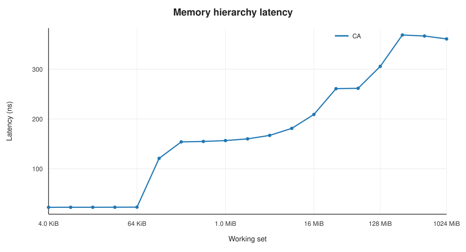

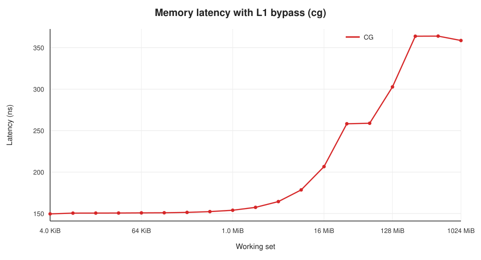

The `cg` curve is essentially flat at about 150 ns until the working set
exceeds L2. The `ca` curve shows three regimes: L1 hits at 22 ns, L2 hits at
150-260 ns, and HBM at about 360 ns.

The prime-stride control gives a slightly lower L2-capacity latency:

| Working set | `ca` half-buffer stride | `ca` prime stride | `cg` half-buffer stride | `cg` prime stride |
|---:|---:|---:|---:|---:|
| 128 MiB | 305.69 ns | 280.17 ns | 302.72 ns | 276.66 ns |
| 1 GiB | 360.89 ns | 363.31 ns | 358.65 ns | 361.22 ns |

#### Analysis

**L1.** A 22.4 ns hit is 53 cycles at 2.36 GHz. This is deeper than the
32-36 cycles reported for the H20 L1 in the reference report. The difference is
a pipeline-depth difference, not a bandwidth difference; the L1 bandwidth in
Test 4 is high. The L1 capacity is about 128 KiB: the latency jumps between
128 KiB and 256 KiB, and the `cg` curve does not jump because it bypasses L1.

**L2.** A 150-160 ns hit is 356-370 cycles. The `ca` and `cg` curves converge
once the working set exceeds L1, confirming that `cg` bypasses L1 and lands in
L2. The L2 latency is not a flat step: it rises from 154 ns at 256 KiB to
167 ns at 4 MiB, 181 ns at 8 MiB, 209 ns at 16 MiB, 261 ns at 32-64 MiB,
306 ns at 128 MiB, and 369 ns at 256 MiB. The gradual rise is consistent with a
128 MiB L2 whose hit rate falls as the working set approaches capacity. The
half-way point between the L2 plateau (about 155 ns) and the HBM plateau (about
365 ns) is reached around 32-64 MiB. The L2 is large, but a single-thread
pointer chase does not get a 100% hit rate across the full 128 MiB.

The prime-stride control matters near capacity. At 128 MiB, the half-buffer
stride gives 306 ns, while a prime stride gives 280 ns. The half-buffer stride
creates set conflicts in the 128 MiB L2; the prime stride spreads accesses more
uniformly. The HBM plateau is unaffected (361-363 ns). This is a useful warning
for pointer-chase benchmarks: near L2 capacity, the stride can change the
apparent latency by 8-9%.

**HBM.** The HBM plateau is 360-369 ns (872-891 cycles). It is flat from
256 MiB to 1 GiB, which means the 1 GiB ring is large enough to defeat the L2
and does not introduce a visible TLB cliff. The HBM latency is about 2.3x the
L2 hit latency and about 16x the L1 hit latency. Compared with the H20 reference
(340 ns / 673 cycles), Blackwell HBM latency is about 6-8% higher in
nanoseconds and about 30% higher in cycles, reflecting the deeper SM and memory
pipelines.

**Answer:** L1 22.4 ns / 53 cycles / ~128 KiB; L2 150-306 ns / 356-724 cycles /
128 MiB; HBM 360-369 ns / 872-891 cycles.

---

### 4.3 Test 3: How fast is GDDR7, really?

**Question:** What is the sustained HBM bandwidth, and how does it compare with
the 1.792 TB/s marketing number and the 1.598 TB/s clock-derived number?

**Answer:** The sustained HBM read bandwidth is about **1.54 TB/s** for
1-8 GiB working sets, about 96% of the clock-derived 1.598 TB/s and about 86%
of the 1.792 TB/s marketing peak. Write bandwidth is about 1.46 TB/s; copy and
triad are about 1.43-1.47 TB/s. A 256 MiB working set shows an apparent
1.88 TB/s because the 128 MiB L2 serves part of the transfer.

#### Test Case

`src/bench_bandwidth.cu` runs four float4 kernels:

- `read`: sum a buffer.
- `write`: fill a buffer.
- `copy`: read one buffer and write another.
- `triad`: read two buffers and write a third.

It also measures `cudaMemcpyAsync` device-to-device (copy engine) and
`cudaMemsetAsync`. The grid is capped at 1,504 blocks (8 per SM) of 256 threads.
Each operation is measured warm (many iterations) and cold (L2 flushed, one
iteration). The large-size numbers in the table below are warm measurements;
for working sets above L2, warm and cold agree.

#### Experimental Results

Warm bandwidth in GB/s (bytes moved / time):

| Working set | Read | Write | Copy | Triad |
|---:|---:|---:|---:|---:|
| 256 MiB | 1,877 | 1,859 | 1,670 | 1,660 |
| 512 MiB | 1,747 | 1,529 | 1,512 | 1,488 |
| 1 GiB | 1,541 | 1,479 | 1,438 | 1,470 |
| 2 GiB | 1,539 | 1,467 | 1,436 | 1,469 |
| 4 GiB | 1,537 | 1,465 | 1,435 | 1,469 |
| 8 GiB | 1,536 | 1,456 | 1,434 | 1,468 |

Additional 8 GiB measurements: `memset` 1,532 GB/s, `cudaMemcpy` D2D
(copy engine) 1,461 GB/s.

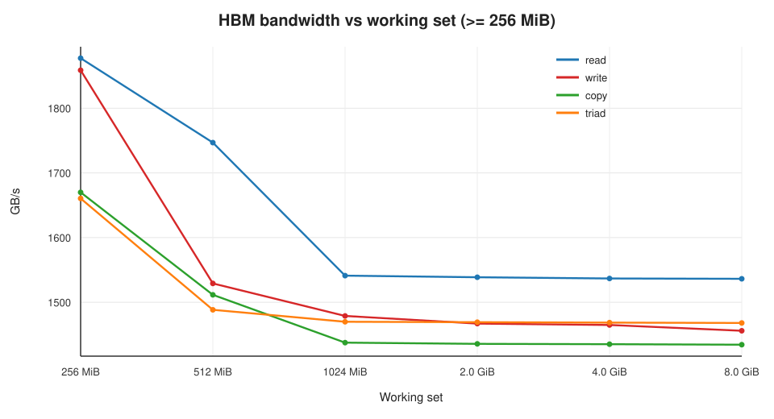

*Figure: HBM regime (working sets of 256 MiB and larger). Smaller working sets
are cache-dominated and are omitted from this plot; their bandwidth is in the
raw CSV.*

#### Analysis

**The two peaks.** NVML reports a 12,481 MHz memory clock and a 512-bit bus.
The DDR-style calculation gives 1,598 GB/s. NVIDIA's marketing specification
for this card is 1,792 GB/s. The measured sustained read of 1.536 TB/s is:

- 96.1% of the clock-derived 1.598 TB/s.
- 85.7% of the marketing 1.792 TB/s.

ECC is enabled. ECC on GDDR7 consumes bandwidth for check bits and can reduce
the effective payload rate; protocol overhead (command, refresh, bank
conflicts) accounts for the rest. On this card, the clock-derived 1.598 TB/s is
a better predictor of sustained payload bandwidth than the marketing peak. The
marketing number may refer to a different memory speed bin or a non-ECC
configuration.

**Why 256 MiB looks faster.** The 256 MiB read reaches 1.877 TB/s, above both
peaks. The L2 is 128 MiB, so a 256 MiB working set can be about half resident.
The read kernel's grid-stride pattern keeps re-reading the same buffer; the L2
serves the resident half, and the apparent bandwidth rises. At 512 MiB the L2
can hold at most a quarter of the buffer, and the apparent read bandwidth falls
to 1.747 TB/s. At 1 GiB and above, the L2 hit rate is small and the HBM plateau
is about 1.54 TB/s. This is a cache effect, not a sudden HBM slowdown.

**Read/write asymmetry.** Read (1.54 TB/s) is about 5% faster than write
(1.46 TB/s). Copy (1.43 TB/s) and triad (1.47 TB/s) are limited by the mix of
reads and writes and by L2 write-allocate behavior. `memset` (write-only)
reaches 1.53 TB/s, close to the read plateau; `cudaMemcpy` D2D through the copy
engine reaches 1.46 TB/s, essentially the same as the SM copy kernel. The copy
engine is not a faster path for large device-to-device copies on this GPU.

**No TLB cliff.** The 1-8 GiB read bandwidth is flat at 1.536-1.541 TB/s. If
TLB reach were the limiting factor, we would expect a further drop as the
working set grows from 1 GiB to 8 GiB; the flat plateau indicates that the L2
hit-rate transition, not TLB, explains the 256 MiB-to-1 GiB drop.

**Answer:** Sustained HBM read ~1.54 TB/s, write ~1.46 TB/s, copy ~1.43 TB/s,
triad ~1.47 TB/s; 96% of the clock-derived 1.598 TB/s and 86% of the 1.792 TB/s
marketing peak.

---

### 4.4 Test 4: How fast are L1, L2, and shared memory?

**Question:** What are the cache and shared-memory bandwidths, and how costly
are shared-memory bank conflicts?

**Answer:** L1 read bandwidth is 39.84 TB/s aggregate (211.9 GB/s per SM);
L2 read bandwidth is 7.97 TB/s (42.4 GB/s per SM); shared-memory read bandwidth
is 25.97 TB/s (138.1 GB/s per SM). Shared-memory latency is 34 cycles
(14.0 ns). A 32-way bank-conflict stride reduces shared bandwidth by about
11.6x, not 32x, because multiple warps hide part of the conflict.

#### Test Case

`src/bench_cache.cu` measures:

- **L1 read:** each block repeatedly reads its own 64 KiB buffer; one block per
  SM, 1,024 threads.
- **L2 read:** one block per SM, each block reads the whole 16 MiB buffer, so
  the per-block working set exceeds L1 and the loads are served by L2.
- **Shared read:** each block reads a 64 KiB shared-memory array.
- **Bank conflicts:** the same shared array with strides 1, 2, 4, 8, 16, and 32.
- **Shared latency:** a pointer chase inside shared memory.

#### Experimental Results

| Resource | Aggregate | Per SM | Per SM per cycle |
|---|---:|---:|---:|
| L1 read | 39.84 TB/s | 211.9 GB/s | 87.2 B/cycle |
| L2 read | 7.97 TB/s | 42.4 GB/s | 17.4 B/cycle |
| Shared read | 25.97 TB/s | 138.1 GB/s | 56.8 B/cycle |
| Shared latency | 34.0 cycles | 14.0 ns | - |

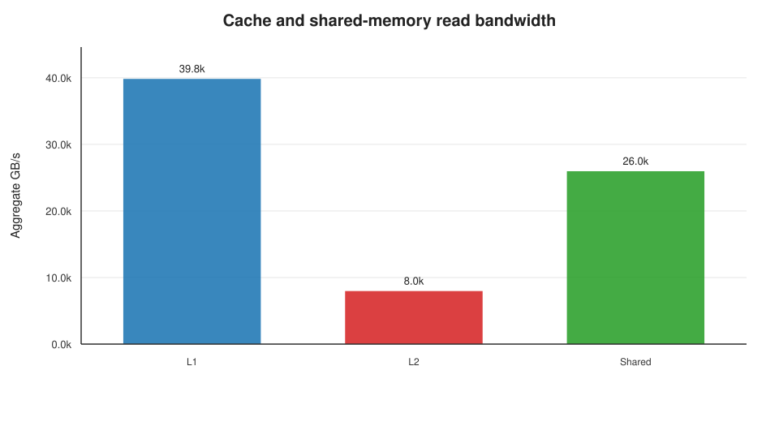

Shared-memory bank-conflict sweep (relative to stride 1):

| Stride | Aggregate GB/s | Relative | Approximate slowdown |
|---:|---:|---:|---:|
| 1 | 21,164 | 1.000 | 1.0x |
| 2 | 20,671 | 0.977 | 1.02x |
| 4 | 14,558 | 0.688 | 1.45x |
| 8 | 7,299 | 0.345 | 2.90x |
| 16 | 3,652 | 0.173 | 5.79x |
| 32 | 1,824 | 0.086 | 11.6x |

#### Analysis

The per-SM bandwidth hierarchy is L1 (87 B/cycle) > shared (57 B/cycle) >
L2 (17 B/cycle). The L1 is about 5x the L2 per SM, and shared memory is about
3.3x the L2. The L2 aggregate (7.97 TB/s) is about 5.2x the sustained HBM
bandwidth (1.54 TB/s), which matches the NoC saturation measurement in Test 7.
The L2 is the central on-chip bottleneck for L2-resident workloads.

Shared memory is fast but not free. A 34-cycle latency and 57 B/cycle/SM make
it roughly 1.5x slower than L1 per byte. The bank-conflict data shows the usual
pattern: stride 1 and 2 are effectively free (the hardware has enough
bank-level parallelism or dual-port behavior to absorb a 2-way conflict), while
stride 4, 8, 16, and 32 degrade to 1.45x, 2.90x, 5.79x, and 11.6x slowdowns.
The 32-way case is not 32x slower because 32 warps are resident and the SM can
issue other warps while one warp waits for its conflicted access.

The 64 KiB shared allocation per block forces one block per SM (16.7%
occupancy), as measured in Test 1. This is the central tradeoff for
shared-memory-heavy kernels on this GPU: a large tile buys fewer global loads
but costs occupancy.

---

### 4.5 Test 5: What do the scalar pipelines deliver?

**Question:** What are the FP32, FP64, INT32, SFU, and FP16 throughputs, and
what is the dependent FMA latency?

**Answer:** FP32 FMA delivers **100.53 TFLOPS** (86.0% of the 116.95 TFLOPS
theoretical peak at 2.43 GHz). FP64 delivers 1.529 TFLOPS, about 1/65.8 of
FP32. INT32 delivers 28.21 TOPS, SFU 7.26 TOPS, and FP16 HFMA2 112.55 TFLOPS.
Dependent FMA latency is 4.44 cycles; independent throughput is 1.14 cycles per
FMA per thread.

#### Test Case

`src/bench_compute.cu` uses inline PTX for each operation:

- `fma.rn.f32`, 8 independent accumulators.
- `fma.rn.f64`, 8 independent accumulators.
- `mad.lo.s32`, 8 independent accumulators.
- `ex2.approx.f32`, 8 independent accumulators.
- `__hfma2`, 8 independent `__half2` accumulators.
- A dependent FP32 FMA chain and an independent FP32 throughput kernel, both
  with one thread per SM, to measure latency and per-thread issue rate.

The peak kernels launch 564 blocks (3 per SM) of 512 threads, i.e. 100%
occupancy, and are preceded by a 0.6 s warm-up to move the GPU out of its idle
clock state.

#### Experimental Results

| Metric | Measured | Per SM per cycle | Note |
|---|---:|---:|---|
| FP32 FMA | 100.53 TFLOPS | 220.1 FLOPs/cycle | 86.0% of 116.95 TFLOPS at 2.43 GHz |
| FP64 FMA | 1.529 TFLOPS | 3.35 FLOPs/cycle | 1/65.8 of FP32 |
| INT32 IMAD | 28.21 TOPS | 61.7 ops/cycle | ~96% of 64 lanes |
| SFU EX2 | 7.26 TOPS | 15.9 ops/cycle | 4 per partition |
| FP16 HFMA2 | 112.55 TFLOPS | 246.4 FLOPs/cycle | ~96% of 256 |
| FP32 dependent FMA | 4.44 cycles/FMA | - | one dependent chain per SM |
| FP32 independent FMA | 1.14 cycles/FMA | - | one thread, 8 accumulators |

#### Analysis

**FP32.** The measured 100.53 TFLOPS is 86% of the theoretical 116.95 TFLOPS
at the maximum 2.43 GHz clock. The 14% gap is instruction issue and loop
overhead: each iteration contains 8 FMAs plus index arithmetic and a branch.
The independent-throughput kernel shows that a single thread can issue an FMA
every 1.14 cycles, so the scheduler is not the problem; the peak kernel is
limited by the mix of arithmetic and control instructions and by the 8-way ILP.
The power test (Test 10) confirms the GPU sustains 2,422 MHz, so the gap is not
a clock-throttling artifact.

**FP64.** 1.529 TFLOPS is 1/65.8 of FP32, confirming a 1/64 FP64 rate. This is
a workstation/consumer Blackwell part, not a datacenter FP64 engine. FP64-heavy
code should be moved to a datacenter GPU or to FP32/FP16 emulation.

**INT32 and SFU.** INT32 reaches 61.7 ops/cycle/SM, close to the 64-lane
integer pipe (96%). SFU reaches 15.9 ops/cycle/SM, essentially the expected
16 ops/cycle (4 per SM partition). These are well-provisioned relative to FP32.

**FP16.** HFMA2 reaches 246 FLOPs/cycle/SM, about 96% of a 256-FLOP/cycle
peak (64 HFMA2 lanes × 4 FLOPs). The FP16 vector path is not the fast path for
matrix math on this GPU; the tensor cores (Test 6) are 4x faster even for FP16
and 16x faster for packed FP4.

**Latency.** A dependent FMA chain takes 4.44 cycles per FMA, consistent with a
4-cycle FMA pipeline. The independent kernel's 1.14 cycles/FMA shows that a
single warp can keep the FP32 pipe nearly full; the SM's four schedulers can
therefore keep 128 FP32 lanes busy.

---

### 4.6 Test 6: How fast are the tensor cores?

**Question:** What are the FP16, BF16, FP8, and FP4 tensor-core throughputs,
and is FP4 really 2x FP8?

**Answer:** FP16 and BF16 deliver about **466.6 TFLOPS**; FP8 delivers
**932.7 TFLOPS**; packed FP4 delivers **1.81 PFLOPS**. The unscaled FP4 path
(`kind::f8f6f4`) is **not** faster than FP8 (932.7 TFLOPS) because its 4-bit
elements are padded into 8-bit containers and its instruction shape is k=32.
The 2x FP4 rate requires the block-scaled `kind::mxf4` or `kind::mxf4nvf4`
instructions with k=64 and packed nibbles.

#### Test Case

`src/bench_tensor.cu` uses four code paths:

1. **FP16/BF16 WMMA:** `nvcuda::wmma` 16×16×16 fragments, FP32 accumulator,
   four independent accumulator fragments per warp.
2. **FP8:** `mma.sync.aligned.m16n8k32.row.col.f32.e4m3.e4m3.f32`, four
   independent accumulator sets per warp.
3. **Unscaled FP4:** `mma.sync.aligned.m16n8k32.row.col.kind::f8f6f4.f32.e2m1.e2m1.f32`.
4. **Packed FP4:** `mma.sync.aligned.m16n8k64.row.col.kind::mxf4.block_scale.scale_vec::2X.f32.e2m1.e2m1.f32.ue8m0`
   (MXFP4) and `kind::mxf4nvf4.block_scale.scale_vec::4X...ue4m3` (NVFP4).
   The scale factors are set to 1.0 (`ue8m0` `0x7F`, `ue4m3` `0x38`).

All kernels launch 752 blocks (4 per SM) of 256 threads, with 8 warps per
block. The build uses:

```make
nvcc -gencode arch=compute_120a,code=sm_120a ...
```

The explicit `compute_120a` virtual architecture is required. The shorthand
`-arch=sm_120a` generated `compute_120` PTX in this toolchain and ptxas
rejected the FP4/block-scale instructions as unsupported on `sm_120`.

#### Experimental Results

| Instruction | Throughput | FLOPs/cycle/SM | Relative to FP16 |
|---|---:|---:|---:|
| FP16 WMMA (m16n16k16) | 466.6 TFLOPS | 1,021 | 1.00x |
| BF16 WMMA (m16n16k16) | 466.7 TFLOPS | 1,022 | 1.00x |
| FP8 MMA (m16n8k32) | 932.7 TFLOPS | 2,042 | 2.00x |
| FP4 unscaled (`f8f6f4`, k=32) | 932.7 TFLOPS | 2,042 | 2.00x |
| MXFP4 (`mxf4`, k=64, 2X) | 1,809.8 TFLOPS | 3,962 | 3.88x |
| NVFP4 (`mxf4nvf4`, k=64, 4X) | 1,809.1 TFLOPS | 3,960 | 3.88x |

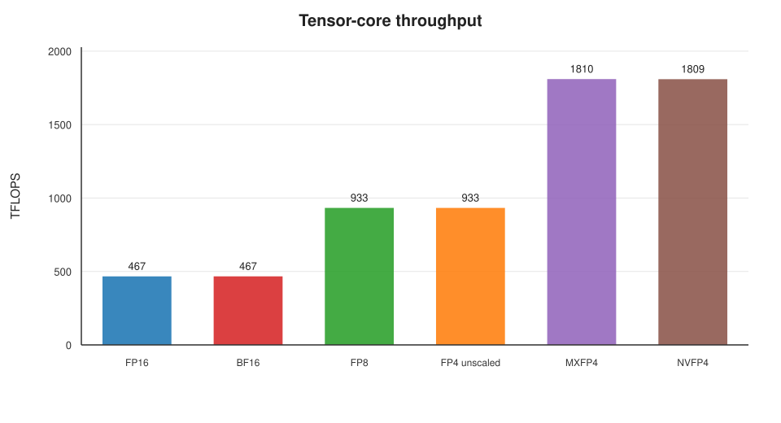

#### Analysis

**The clean scaling.** FP16/BF16 at 466.6 TFLOPS, FP8 at 932.7, packed FP4 at
1.81 PFLOPS: each halving of the input precision doubles the throughput. The
FP8/FP16 ratio is 2.00x and the packed FP4/FP8 ratio is 1.94x. The per-SM
per-cycle numbers (1,021, 2,042, 3,962 FLOPs) are consistent with four tensor
cores per SM and a 2x rate per precision step.

**The FP4 trap.** The unscaled `kind::f8f6f4` path is not faster than FP8.
PTX requires 4-bit and 6-bit elements to be packed in an 8-bit container for
this instruction family, and the instruction shape is k=32. It performs the
same number of MACs as the FP8 `m16n8k32` instruction, so the throughput is
identical (932.7 TFLOPS). A benchmark that uses `kind::f8f6f4` and calls the
result "FP4 peak" will under-report the hardware by a factor of two.

To reach 1.81 PFLOPS, the kernel must use the block-scaled `kind::mxf4` or
`kind::mxf4nvf4` path with k=64 and two FP4 values per byte. This path also
requires `sm_120a`; plain `sm_120` rejects `.kind::mxf4`, `.block_scale`,
`.scale_vec`, and `.e2m1`. This is the single most important build-system
gotcha for FP4 on this GPU.

**Scale-factor caveat.** The microbenchmark holds the scale factors at 1.0 and
does not load them from memory. A real MXFP4/NVFP4 GEMM must load the per-block
scale factors (one `ue8m0` byte per 32 elements for MXFP4; one `ue4m3` byte per
16 elements for NVFP4) and apply the scaling. The 1.81 PFLOPS is the
tensor-core arithmetic ceiling, not an end-to-end GEMM number.

**Power.** A sustained FP4 tensor kernel draws about 245 W steady (peak 267 W)
at 2,422 MHz, compared with about 330 W for the FP32 FMA workload, despite
delivering 18x the FLOPs. The tensor cores are much more energy-efficient. The
comparison is not perfectly normalized: the FP4 kernel runs at 66% occupancy
(4 blocks/SM × 256 threads) while the FP32 kernel runs at 100% occupancy
(3 blocks/SM × 512 threads). The direction is nevertheless clear.

---

### 4.7 Test 7: What is the on-chip network topology?

**Question:** Is the SM-to-SM/L2 network a crossbar or a distance-dependent
mesh? What are its latency and bandwidth?

**Answer:** The network behaves like a **crossbar/full fabric**, not a
distance-dependent mesh. The all-to-all ping-pong latency matrix is nearly
uniform: median 1,254 ns round-trip (627 ns one-way), standard deviation 47 ns,
and a Pearson correlation of only **0.035** between latency and SM-ID distance.
NoC/L2 bandwidth scales linearly at about **77.5 GB/s per SM** up to 64 SMs,
then saturates at **7.2-8.0 TB/s** for 128-188 SMs.

#### Test Case

`src/bench_noc.cu` has two parts.

**Latency/topology.** A cooperative kernel launches one block per SM. Each
block allocates 96 KiB of dynamic shared memory, which forces one block per SM
and guarantees all blocks are resident. In each round, block `i` sends a
timestamped message to block `(i + r) mod N`; every block sends before waiting,
so the network is filled without deadlock. The target responds with an
acknowledgement, and the sender records the round-trip time with
`%globaltimer`. Rotating the target over `N` rounds fills the full `N × N`
matrix; five repetitions are averaged. The block's actual `%smid` is recorded
so the matrix can be analyzed by SM-ID distance.

**Bandwidth.** A separate kernel launches 1 to 188 blocks of 1,024 threads;
each block reads the whole 16 MiB L2-resident buffer. The per-block working set
exceeds L1, so the loads are served by L2. The aggregate and per-SM bandwidth
are reported as a function of the number of active SMs.

#### Experimental Results

Latency versus number of active SMs (median over all pairs):

| Active SMs | Pairs | Median round-trip (ns) | Median one-way (ns) | Min (ns) | Max (ns) |
|---:|---:|---:|---:|---:|---:|
| 2 | 2 | 1,052.8 | 526.4 | 1,049.6 | 1,056.0 |
| 4 | 12 | 1,180.8 | 590.4 | 1,081.6 | 1,248.0 |
| 8 | 56 | 1,273.6 | 636.8 | 1,120.0 | 1,350.4 |
| 16 | 240 | 1,292.8 | 646.4 | 1,088.0 | 1,408.0 |
| 32 | 992 | 1,299.2 | 649.6 | 1,056.0 | 1,414.4 |
| 64 | 4,032 | 1,280.0 | 640.0 | 1,049.6 | 1,420.8 |
| 94 | 8,742 | 1,260.8 | 630.4 | 1,017.6 | 1,440.0 |
| 128 | 16,256 | 1,260.8 | 630.4 | 1,004.8 | 1,459.2 |
| 188 | 35,156 | 1,254.4 | 627.2 | 966.4 | 1,433.6 |

Full-matrix statistics (188 SMs, 35,156 pairs): median 1,254.4 ns, mean
1,251.2 ns, standard deviation 47.1 ns, p5 1,171.2 ns, p95 1,324.8 ns, min
966.4 ns, max 1,433.6 ns. Pearson correlation with `|smid_i - smid_j|`:
**0.035**.

Mean latency by SM-ID distance bin:

| SM-ID distance | Pairs | Mean round-trip (ns) |
|---:|---:|---:|
| 1-3 | 1,116 | 1,237.7 |
| 4-7 | 1,460 | 1,251.7 |
| 8-15 | 2,824 | 1,256.3 |
| 16-31 | 5,264 | 1,246.5 |
| 32-63 | 8,992 | 1,251.6 |
| 64-127 | 11,840 | 1,252.0 |
| 128-255 | 3,660 | 1,254.4 |

Bandwidth scaling:

| Active SMs | Aggregate GB/s | GB/s per SM |
|---:|---:|---:|
| 1 | 77.5 | 77.5 |
| 2 | 155.0 | 77.5 |
| 4 | 309.9 | 77.5 |
| 8 | 618.9 | 77.4 |
| 16 | 1,237.2 | 77.3 |
| 32 | 2,460.2 | 76.9 |
| 64 | 4,905.9 | 76.7 |
| 94 | 7,008.7 | 74.6 |
| 128 | 7,187.2 | 56.2 |
| 188 | 7,985.8 | 42.5 |

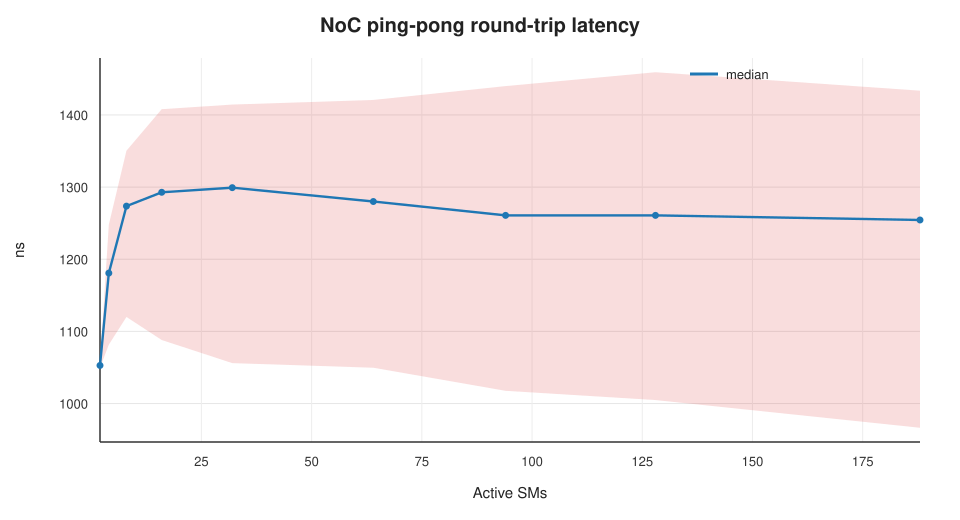

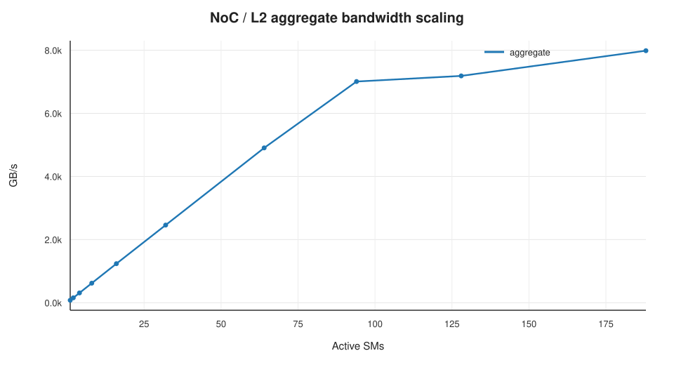

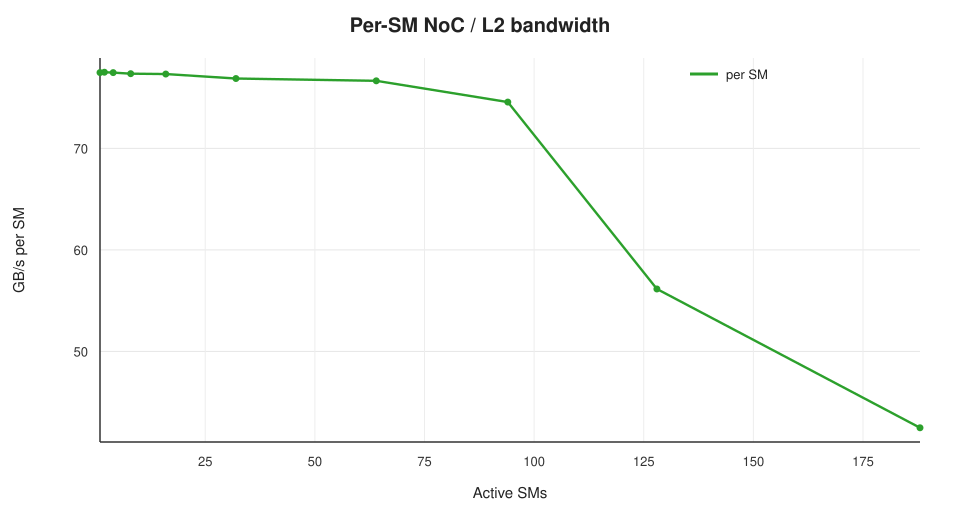

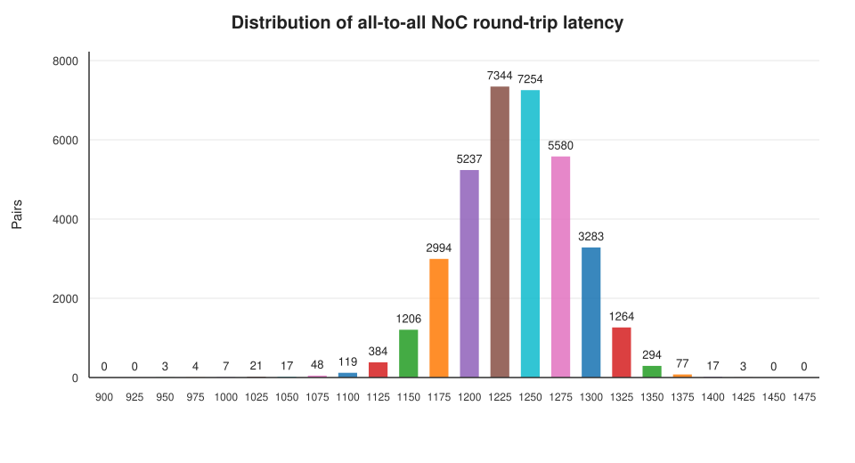

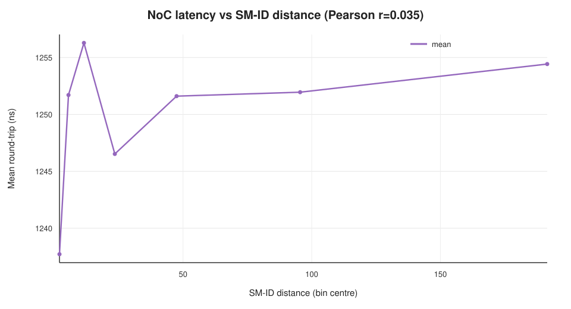

#### Analysis

**Topology: crossbar-like.** The latency matrix is almost flat. The mean
latency varies by only 18.6 ns (1.5%) across SM-ID distance bins from 1-3 to
128-255, and the Pearson correlation is 0.035. A mesh with hop-count-dependent
latency would show a monotonic increase with distance. This is the signature of
a crossbar or a fully connected fabric with a shared L2. The lowest-latency
pairs (966-992 ns) are adjacent SM IDs, which hints at a small
local-adjacency/TPC effect, but it is not a dominant topology signature. The
histogram is unimodal and narrow (standard deviation 47 ns, 3.8% of the mean).

**Latency vs load.** The two-block baseline is 1,052.8 ns. At 32 active blocks
the median rises to 1,299.2 ns (23% higher), then falls back to 1,254.4 ns at
188 blocks. The initial rise is contention; the slight fall at high block counts
is likely a combination of better traffic distribution and the GPU clock
boosting. The overall variation is about 20%, which is modest for a fabric
serving 188 SMs.

**What the 627 ns means.** The ping-pong latency includes the sender's store,
the L2 access, the target's polling loop and atomic acknowledgement, and the
return path. It is a software-level round-trip upper bound, not the raw NoC
transit time. The important topology evidence is the flatness, not the absolute
number. The 627 ns one-way value is in the same range as the H20 report's
649.5 ns remote-load latency over NVLink, but the two paths are different: this
is an on-die SM-to-SM/L2 path, while the H20 number is an inter-GPU NVLink
path.

**Bandwidth: L2-limited.** The per-SM bandwidth is 77.5 GB/s (31.9 B/cycle) at
1-32 SMs, stays above 74 GB/s through 94 SMs, and then collapses to 56.2 GB/s
at 128 SMs and 42.5 GB/s at 188 SMs. The aggregate saturates at about
7.0 TB/s at 94 SMs, 7.19 TB/s at 128, and 7.99 TB/s at 188. The 7.99 TB/s
ceiling matches the L2 read bandwidth measured in Test 4 (7.97 TB/s). The NoC
fabric is not the bottleneck at full chip; the L2 slices are. The NoC is about
5.2x faster than HBM, consistent with the L2/HBM bandwidth ratio.

**Answer:** Crossbar-like topology; 627 ns one-way software round-trip;
77.5 GB/s per SM at low load; ~8 TB/s aggregate, L2-limited.

---

### 4.8 Test 8: How fast is PCIe?

**Question:** What is the host-device bandwidth, and is the GPU running at
Gen5 x16?

**Answer:** The GPU trains to **PCIe Gen5 x8**, not x16. Pinned-memory
bandwidth is **28.1 GB/s host-to-device** and **28.7 GB/s device-to-host**,
about 89-91% of the 31.5 GB/s Gen5 x8 raw rate. Pageable memory delivers
10.7-13.7 GB/s H2D and 17.1-17.3 GB/s D2H.

#### Test Case

`src/bench_pcie.cu` allocates a pinned host buffer with `cudaHostAlloc` and a
device buffer with `cudaMalloc`, then measures `cudaMemcpyAsync` in both
directions for sizes from 1 KiB to 1 GiB. It repeats the large transfers 10
times and the small transfers 20 times, taking the median. A pageable-memory
reference is measured for 64 MiB and 256 MiB. A background `nvidia-smi` monitor
samples the PCIe link generation and width every 100 ms during the run.

#### Experimental Results

Pinned memory:

| Size | H2D GB/s | D2H GB/s | H2D time (us) | D2H time (us) |
|---:|---:|---:|---:|---:|
| 1 KiB | 0.34 | 0.36 | 2.99 | 2.82 |
| 4 KiB | 1.14 | 1.07 | 3.58 | 3.84 |
| 16 KiB | 2.72 | 4.00 | 6.02 | 4.10 |
| 64 KiB | 9.08 | 12.26 | 7.22 | 5.34 |
| 256 KiB | 20.71 | 20.90 | 12.66 | 12.54 |
| 1 MiB | 25.42 | 22.63 | 41.25 | 46.34 |
| 4 MiB | 27.30 | 27.96 | 153.66 | 150.00 |
| 16 MiB | 27.95 | 28.41 | 600.18 | 590.64 |
| 64 MiB | 28.07 | 28.63 | 2,390.85 | 2,344.16 |
| 256 MiB | 28.11 | 28.65 | 9,551.26 | 9,368.91 |
| 512 MiB | 28.09 | 28.67 | 19,111.92 | 18,726.46 |
| 1 GiB | 28.11 | 28.67 | 38,203.01 | 37,450.58 |

Pageable memory:

| Size | H2D GB/s | D2H GB/s |
|---:|---:|---:|
| 64 MiB | 13.68 | 17.14 |
| 256 MiB | 10.71 | 17.28 |

The link monitor reports Gen5 x8 for every sample during the run.

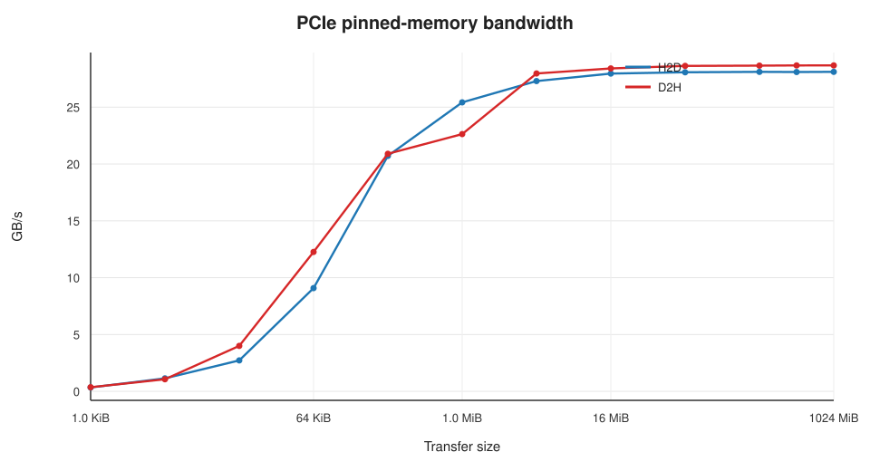

#### Analysis

The GPU supports Gen5 x16, but the link trained to x8. `nvidia-smi -q` reports
max width 16 and current width 8. This is a platform/slot limitation, not a GPU
limitation. The measured 28.1/28.7 GB/s is 89.2%/91.1% of the 31.5 GB/s raw
Gen5 x8 rate (32 GB/s before 128b/130b encoding). The remaining 9-11% is
protocol and encoding overhead.

The bandwidth plateaus at about 28 GB/s for transfers of 4 MiB and larger. At
1 MiB it is 25.4/22.6 GB/s; at 64 KiB it is 9.1/12.3 GB/s; at 1 KiB it is
0.34 GB/s with about 3 us of latency. Small transfers are latency-bound, not
bandwidth-bound. D2H is slightly faster than H2D at large sizes, consistent
with PCIe read/write efficiency.

Pageable memory is much slower: H2D drops to 10.7-13.7 GB/s and D2H to
17.1-17.3 GB/s. Pinned memory is 2-2.6x faster for H2D and 1.7x for D2H. Any
bandwidth-sensitive pipeline should use pinned (or registered) host memory.

The GPU is on NUMA node 1. The benchmark did not pin the host thread to that
node, so a small NUMA penalty may be present. The link limit dominates,
however; a NUMA-pinned run is unlikely to change the large-transfer number by
more than a few percent.

**Answer:** Gen5 x8; 28.1 GB/s H2D, 28.7 GB/s D2H pinned; 10.7-17.3 GB/s
pageable.

---

### 4.9 Test 9: How does the warp scheduler behave?

**Question:** How many warps and blocks can the SM keep resident, and how does
instruction issue scale with the number of warps?

**Answer:** 48 warps and 24 blocks per SM; 100% occupancy for 64-512-thread
blocks, 66.7% for 1,024-thread blocks, and 50% for 32-thread blocks. Shared
memory is the main occupancy limiter. Issue rate saturates once 8 warps are
resident.

#### Test Case

`src/bench_scheduler.cu` launches an independent integer-add kernel with
1-32 warps per SM and measures the number of counted ADD instructions per
cycle. It also queries the occupancy API for dynamic shared-memory sizes from 0
to 96 KiB.

#### Experimental Results

Issue scaling:

| Threads | Warps | Cycles | Counted ADD instr/cycle |
|---:|---:|---:|---:|
| 32 | 1 | 1,750,175 | 0.457 |
| 64 | 2 | 1,750,168 | 0.914 |
| 128 | 4 | 1,750,178 | 1.828 |
| 256 | 8 | 2,600,194 | 2.461 |
| 512 | 16 | 5,200,212 | 2.461 |
| 1,024 | 32 | 10,400,264 | 2.461 |

Occupancy versus dynamic shared memory (empty kernel, 256 threads):

| Shared bytes | Blocks/SM | Occupancy |
|---:|---:|---:|
| 0 | 6 | 100.0% |
| 16 KiB | 5 | 83.3% |
| 32 KiB | 3 | 50.0% |
| 64 KiB | 1 | 16.7% |
| 96 KiB | 1 | 16.7% |

#### Analysis

The occupancy table is the useful result. The SM can hold 48 warps, but the
thread limit (1,536) and the shared-memory limit (100 KiB) interact:

- 64-512-thread blocks reach 100% occupancy.
- 1,024-thread blocks are capped at one block per SM (66.7%).
- 32-thread blocks are capped at 24 blocks per SM (50%).
- 64 KiB of shared memory per block leaves room for only one block per SM
  (16.7%); 32 KiB allows three blocks (50%); 16 KiB allows five (83.3%).

The issue-rate table should be read as a relative scaling check, not an exact
peak. The kernel counts only the eight accumulator adds per iteration; the loop
also contains index arithmetic and a branch, so the true instruction issue rate
is higher than the counted ADD rate. The counted rate rises from 0.457 at one
warp to 2.461 at eight warps and then stays flat, showing that eight warps are
enough to saturate the four schedulers. The FP32 independent-throughput result
from Test 5 (1.14 cycles/FMA per thread) and the FP32 peak (86% of theoretical)
are more reliable indicators of scheduler efficiency.

For kernels with large shared-memory tiles, the occupancy loss is real. A
64 KiB tile leaves one block per SM; if that block has only 256 threads, the SM
runs at 16.7% occupancy and has just 8 warps. The 4-scheduler SM can still issue
from 8 warps, but latency hiding for global loads is limited. A 32 KiB tile
(three blocks, 24 warps) is a better default unless the algorithm needs the
larger tile.

---

### 4.10 Test 10: How does the GPU behave under sustained load?

**Question:** Does the GPU sustain its maximum clock, how much power does it
draw, and does it throttle?

**Answer:** The GPU sustains **2,422 MHz** (99.7% of the 2,430 MHz maximum) for
an 18.5 s FP32 workload and for an 18 s FP4 tensor workload. FP32 power is
304-429 W (steady average 330 W); FP4 tensor power is about 245-253 W steady
(peak 267 W). Temperature stays at 56-66 C for FP32 and 52-55 C for FP4. No
software power cap, thermal slowdown, or hardware slowdown is reported.

#### Test Case

`src/bench_power.cu` launches a long FP32 FMA kernel and samples NVML every
500 ms: SM clock, memory clock, power, temperature, GPU utilization, and the
current clock-throttle reason mask. `bench_tensor --power` runs the same
measurement for a long FP4 tensor kernel. The tool reports min/avg/max for
clock, power, and temperature, and flags any sample with the software power-cap
bit set.

#### Experimental Results

Idle:

| Metric | Value |
|---|---:|
| SM clock | 180 MHz |
| Memory clock | 405 MHz |
| Power | 36-42 W |
| Temperature | 39-42 C |

Sustained FP32 (18.5 s, 37 samples):

| Metric | Min | Average | Max |
|---|---:|---:|---:|
| SM clock | 2,422 MHz | 2,422 MHz | 2,422 MHz |
| Memory clock | 12,481 MHz | 12,481 MHz | 12,481 MHz |
| Power | 238.7 W | 324.8 W | 428.7 W |
| Temperature | 56 C | 61 C | 66 C |

Steady-state FP32 (2-17 s, 30 samples): average 329.9 W, min 304.0 W, max
428.7 W.

Sustained FP4 tensor (18 s, 36 samples): 2,422 MHz under load, 244.3 W average
including ramp-up, about 245-253 W steady, peak 266.7 W, 52-55 C. No throttle
samples.

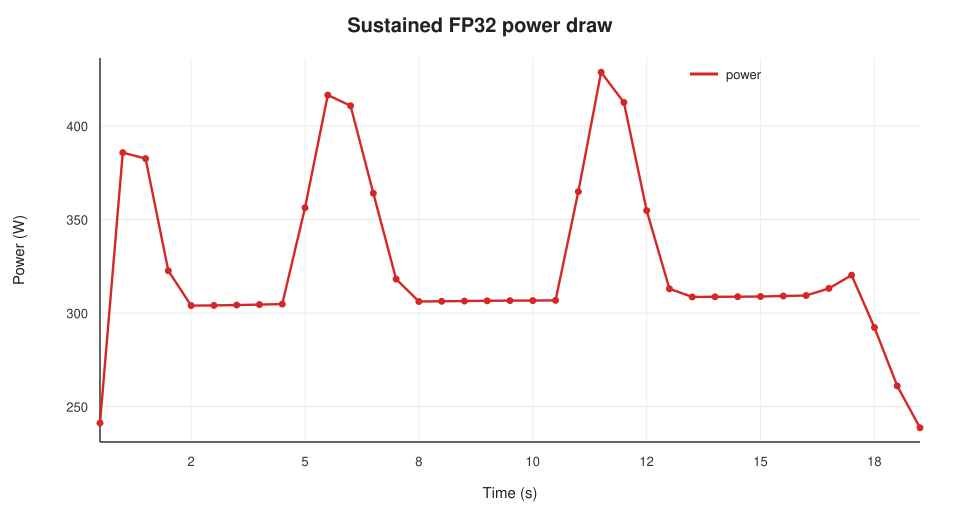

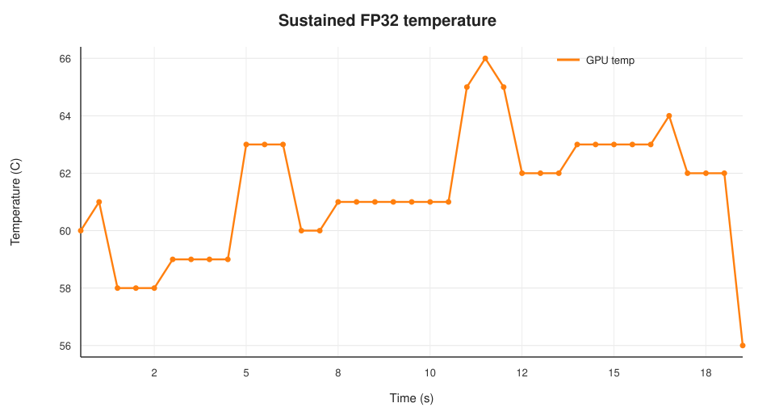

#### Analysis

The clock behavior is simple: the GPU boosts to 2,422 MHz and stays there. The
8 MHz gap from the 2,430 MHz maximum is within the reported clock granularity.
There is no clock drop over 18.5 s, no thermal slowdown, and no software power
cap. The 600 W limit is not the constraint for either workload.

The FP32 power trace oscillates between about 305 W and 429 W with a period of
roughly 5 s. The average is stable at about 330 W. The oscillation is likely a
power-management loop (the GPU alternates between power states or adjusts
voltage/frequency within the boost envelope) rather than a workload phase
change; the clock remains pinned at 2,422 MHz. Even the peak 429 W is only 71%
of the 600 W limit.

The FP4 tensor workload draws less power (about 245-253 W) than the FP32
workload despite delivering 18x the FLOPs. The tensor cores are much more
energy-efficient than the scalar FP32 pipes. The comparison is not perfectly
normalized: the FP4 kernel runs at 66% occupancy and the FP32 kernel at 100%,
so a higher-occupancy FP4 kernel might draw more. The direction is unambiguous.

The idle behavior is aggressive: 180 MHz, 36-42 W, 39-42 C. The GPU downclocks
to P8 when idle and ramps to 2,422 MHz in under a second when work arrives.

**Answer:** 2,422 MHz sustained; 330 W FP32, 245-253 W FP4; 66 C maximum; no
throttling.

---

## 5. Summary

### 5.1 Key numbers

| Category | Metric | Value |
|---|---|---:|
| SM | SMs | 188 |
| SM | FP32 lanes | 24,064 |
| SM | Threads / warps per SM | 1,536 / 48 |
| SM | Blocks per SM | 24 |
| SM | Registers per SM | 65,536 |
| SM | Shared memory per SM | 100 KiB |
| Cache | L2 | 128 MiB |
| Cache | L1 read bandwidth | 39.84 TB/s (211.9 GB/s/SM) |
| Cache | L2 read bandwidth | 7.97 TB/s (42.4 GB/s/SM) |
| Cache | Shared read bandwidth | 25.97 TB/s (138.1 GB/s/SM) |
| Latency | L1 hit | 22.4 ns / 53 cycles |
| Latency | L2 hit | 150-160 ns / 356-370 cycles |
| Latency | L2 at 128 MiB | 306 ns / 724 cycles |
| Latency | HBM | 360-369 ns / 872-891 cycles |
| HBM | Sustained read | 1.54 TB/s |
| HBM | Sustained write | 1.46 TB/s |
| HBM | Sustained copy / triad | 1.43 / 1.47 TB/s |
| HBM | vs clock-derived 1.598 TB/s | 96% |
| HBM | vs marketing 1.792 TB/s | 86% |
| Compute | FP32 FMA | 100.53 TFLOPS |
| Compute | FP64 FMA | 1.529 TFLOPS |
| Compute | INT32 IMAD | 28.21 TOPS |
| Compute | SFU EX2 | 7.26 TOPS |
| Compute | FP16 HFMA2 | 112.55 TFLOPS |
| Compute | FMA latency / throughput | 4.44 / 1.14 cycles |
| Tensor | FP16 / BF16 | 466.6 / 466.7 TFLOPS |
| Tensor | FP8 | 932.7 TFLOPS |
| Tensor | FP4 unscaled (`f8f6f4`) | 932.7 TFLOPS |
| Tensor | MXFP4 / NVFP4 | 1.81 / 1.81 PFLOPS |
| NoC | Median round-trip | 1,254 ns |
| NoC | Median one-way | 627 ns |
| NoC | Latency std / correlation with distance | 47 ns / 0.035 |
| NoC | Per-SM bandwidth | 77.5 GB/s |
| NoC | Aggregate peak | 7.99 TB/s |
| PCIe | Link | Gen5 x8 |
| PCIe | Pinned H2D / D2H | 28.1 / 28.7 GB/s |
| Power | FP32 steady average / peak | 330 / 429 W |
| Power | FP4 tensor steady / peak | 245-253 / 267 W |
| Power | Sustained SM clock | 2,422 MHz |
| Power | Max temperature | 66 C |
| Power | Throttle | None |

### 5.2 What surprised us

1. **Shared memory is only 100 KiB per SM.** A 64 KiB tile drops occupancy to
   16.7%. Hopper-style 64 KiB tiling assumptions do not transfer unchanged.
2. **FP64 is a 1/64-rate pipe.** At 1.53 TFLOPS it is not a datacenter FP64
   engine. FP64-heavy work belongs on a different GPU.
3. **Unscaled FP4 is not faster than FP8.** The `kind::f8f6f4` path pads 4-bit
   elements into 8-bit containers and runs at 932.7 TFLOPS, the same as FP8.
   The 2x FP4 rate requires block-scaled `kind::mxf4`/`kind::mxf4nvf4` with
   packed nibbles and `sm_120a`.
4. **The PCIe slot is x8, not x16.** The 28 GB/s ceiling is a platform limit.
   The card itself supports Gen5 x16.
5. **The NoC is distance-independent.** The latency matrix is flat
   (r = 0.035 vs SM-ID distance), consistent with a crossbar/full fabric. The
   aggregate bandwidth saturates at the L2, not at the NoC.
6. **Sustained HBM is 86% of the marketing peak.** The clock-derived 1.598 TB/s
   is the better baseline; ECC and protocol overhead explain the gap. The
   256 MiB "1.88 TB/s" number is an L2 hit-rate artifact.
7. **The GPU sustains 2,422 MHz at 330 W with no throttling.** The 600 W limit
   is far away for these workloads; FP4 tensor work is more efficient than FP32
   scalar work.

---

## 6. References

1. NVIDIA, *RTX PRO 6000 Blackwell Workstation Edition / Server Edition*
   product documentation and specifications.
2. NVIDIA, *CUDA C++ Programming Guide*, sections on warp matrix functions
   (WMMA), device attributes, and occupancy.
   <https://docs.nvidia.com/cuda/cuda-c-programming-guide/index.html>
3. NVIDIA, *PTX ISA 9.4* (CUDA 13.4), sections on `mma.sync`, matrix fragments,
   FP8/FP6/FP4 alternate floating-point types, and warp-level block scaling.
   <https://docs.nvidia.com/cuda/parallel-thread-execution/index.html>
4. NVIDIA, *CUDA Toolkit 13.4 Release Notes*.
   <https://docs.nvidia.com/cuda/cuda-toolkit-release-notes/index.html>
5. *Secrets Behind NVIDIA GPGPU*, the H20 report that inspired this study.
6. NVIDIA CUTLASS, `include/cute/arch/mma_sm120.hpp`, SM120 MMA atoms for
   `float_e2m1_t`, `float_e4m3_t`, and the block-scaled MXFP4/NVFP4 variants.
   <https://github.com/NVIDIA/cutlass>
7. NVIDIA Nsight Compute documentation (optional profiling workflow).
   <https://docs.nvidia.com/nsight-compute/>
8. This repository:
   <https://github.com/baichen318/gpgpu-microbenchmark/tree/main/rtx-pro-6000-blackwell>

---

## 7. Appendix: Reproducibility

### 7.1 Build

```bash
cd rtx-pro-6000-blackwell
make -j
```

The default architecture is `sm_120a`, and the build uses the explicit
two-part gencode form:

```make
NVCCFLAGS ?= -O3 -std=c++17 \
  -gencode arch=compute_120a,code=sm_120a \
  -lineinfo -Xcompiler -Wall
```

The explicit `compute_120a` virtual architecture is required for the FP4
block-scaled instructions. The shorthand `-arch=sm_120a` generated
`compute_120` PTX in this toolchain and ptxas rejected `.kind::mxf4`,
`.block_scale`, `.scale_vec`, and `.e2m1` as unsupported on `sm_120`.

### 7.2 Run

```bash
./scripts/run_all.sh
```

The script writes raw CSV files to `results/raw/`, a run log, and a system
snapshot. It runs the benchmarks sequentially so they do not contend for the
GPU. The power test takes about 19 s; the full suite takes several minutes.

### 7.3 Regenerate figures and tables

```bash
python3 scripts/make_figures.py
```

The script uses only the Python standard library and writes SVG figures to
`report/figures/`.

### 7.4 Raw data files

| File | Contents |
|---|---|
| `device_info.csv` | Device properties and attributes |
| `device_info_occupancy.csv` | Occupancy vs block size |
| `memory_latency.csv` | Pointer-chase latency, `ca` and `cg` |
| `memory_latency_prime.csv` | Prime-stride control |
| `memory_bandwidth.csv` | Read/write/copy/triad, warm and cold |
| `cache.csv` | L1/L2/shared bandwidth, bank conflicts, shared latency |
| `compute.csv` | FP32/FP64/INT32/SFU/FP16 and FMA latency |
| `tensor.csv` | FP16/BF16/FP8/FP4 tensor throughput |
| `noc_latency.csv` | Ping-pong latency vs active SMs |
| `noc_bandwidth.csv` | NoC/L2 bandwidth vs active SMs |
| `noc_matrix.csv` | Full 188 × 188 latency matrix |
| `noc_summary.csv` | Matrix summary statistics |
| `noc_distance_bins.csv` | Latency vs SM-ID distance |
| `pcie.csv` | Pinned and pageable PCIe bandwidth |
| `pcie_link_monitor.csv` | Link generation/width during the PCIe run |
| `scheduler.csv` | Issue scaling and shared-memory occupancy |
| `power.csv` | FP32 power/clock/temperature time series |
| `tensor_power_monitor.csv` | FP4 tensor power/clock/temperature |
| `system_info.txt` | `nvidia-smi -q`, topology, CPU, memory |

### 7.5 Caveats

- The machine is shared. Other users' activity can affect clocks, memory
  bandwidth, and PCIe bandwidth. The measurements reported here were taken with
  no other GPU processes visible.
- ECC is enabled. ECC reduces the effective HBM payload bandwidth; the 1.54
  TB/s sustained number includes that cost.
- The PCIe link is x8. A x16 slot would roughly double the PCIe ceiling.
- The GPU is a single device. There is no NVLink/NVSwitch, so the original
  report's multi-GPU tests are not applicable.
- The FP4 tensor number is a compute-only ceiling with scale factors fixed at
  1.0. A real MXFP4/NVFP4 GEMM will be lower due to scale-factor loads and
  dequantization.
- Clock locking was not used. The GPU sustained 2,422 MHz in these runs, but
  run-to-run clock variation of a few MHz is expected.

---

*End of report.*
